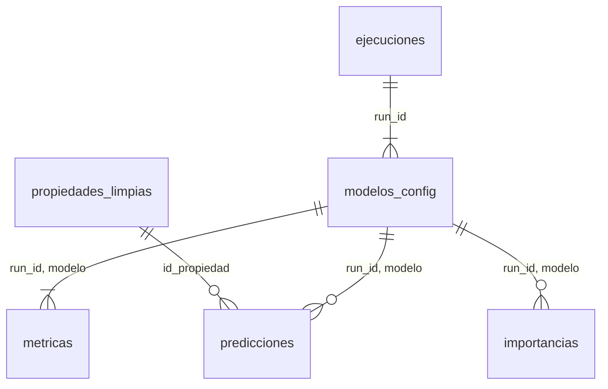
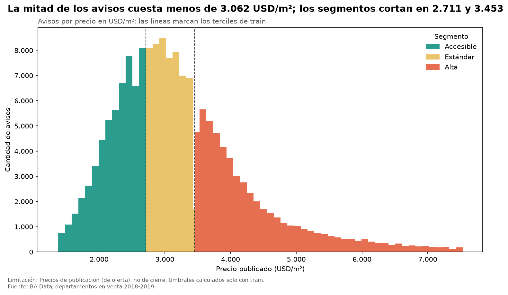
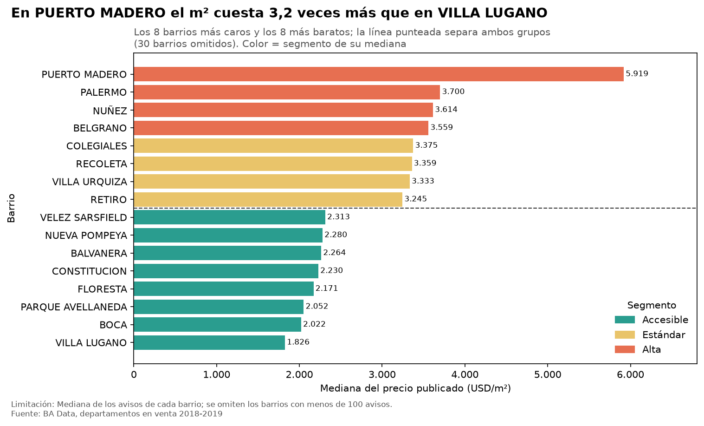
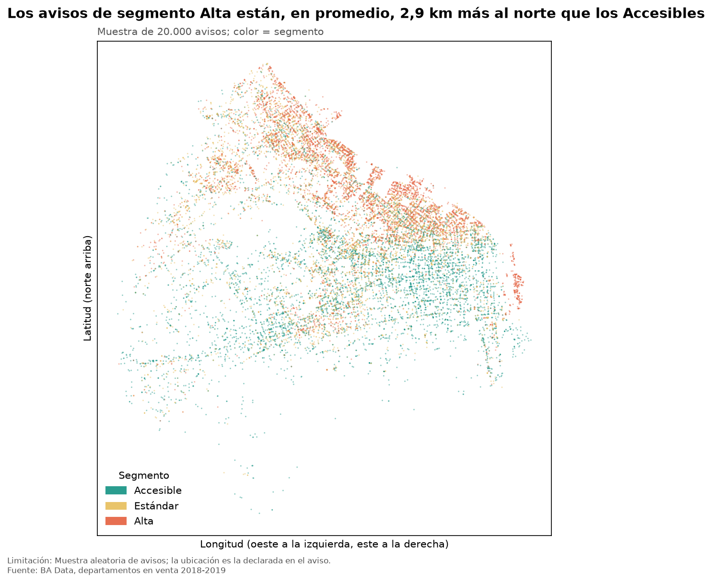
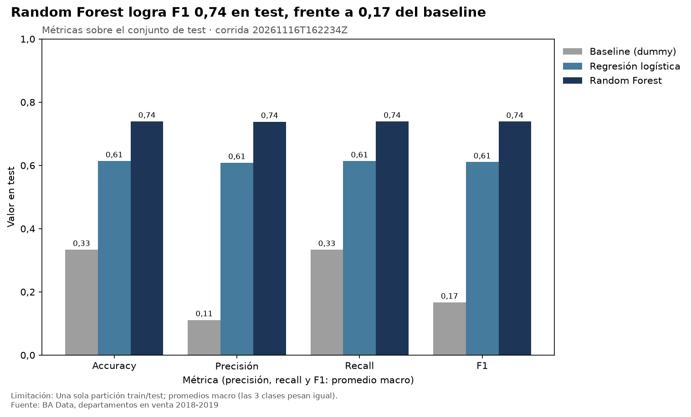
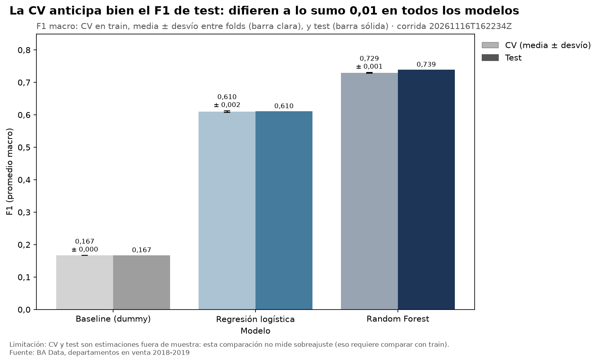
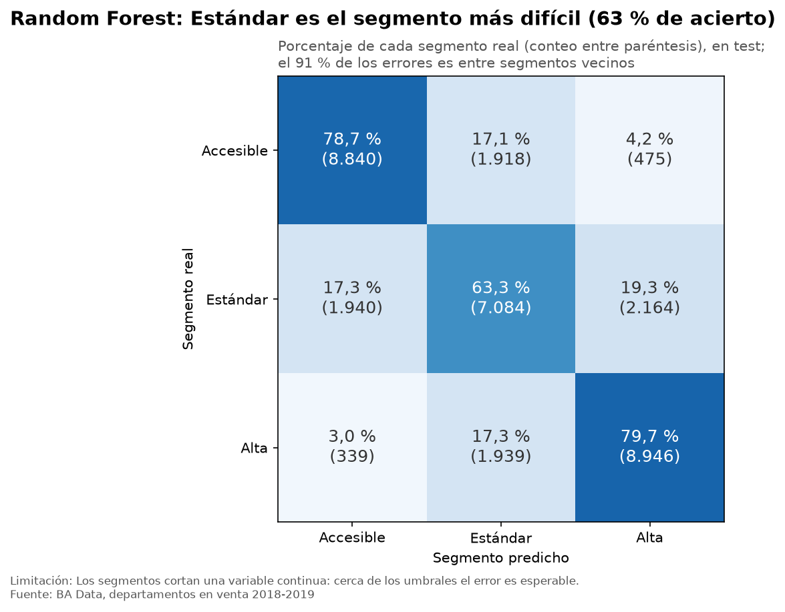
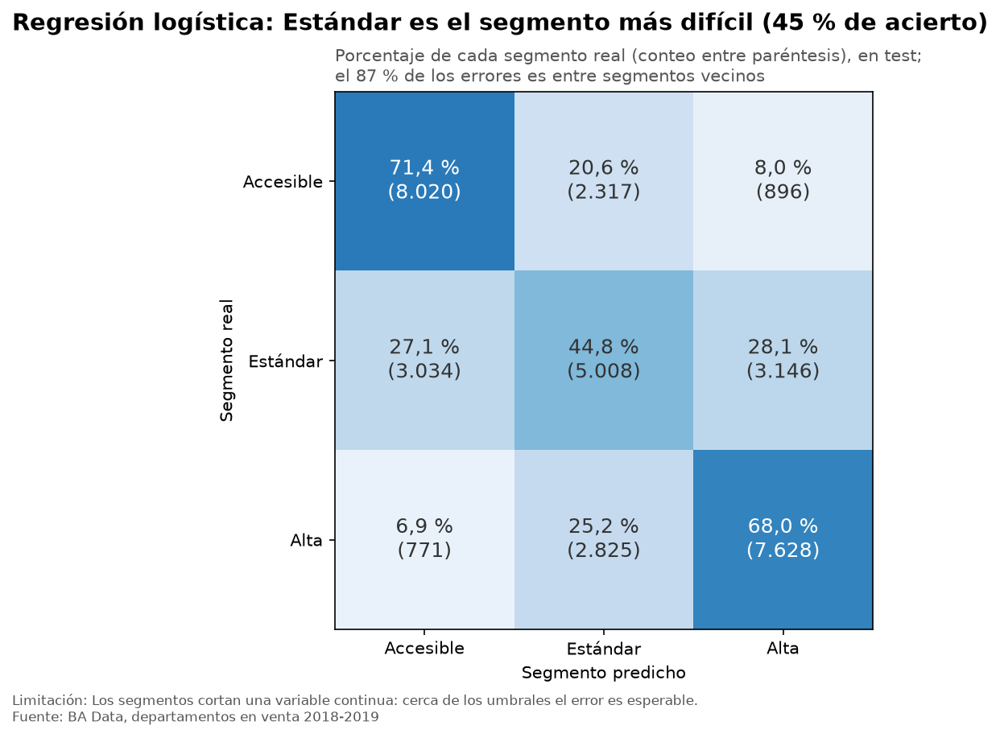
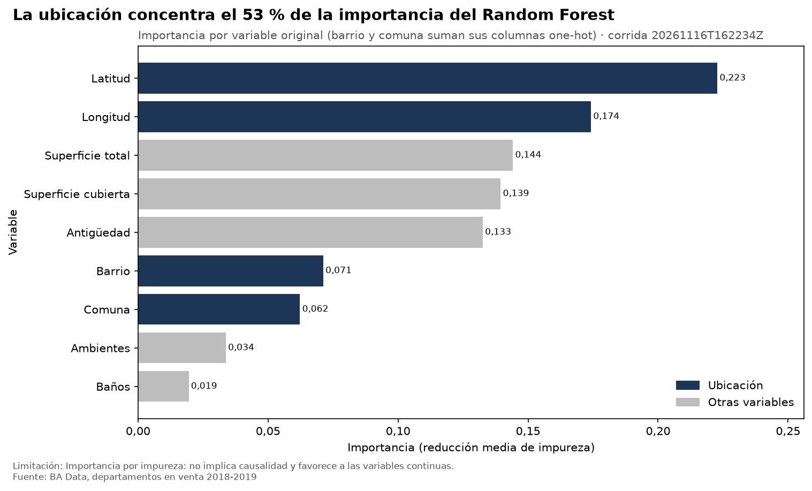
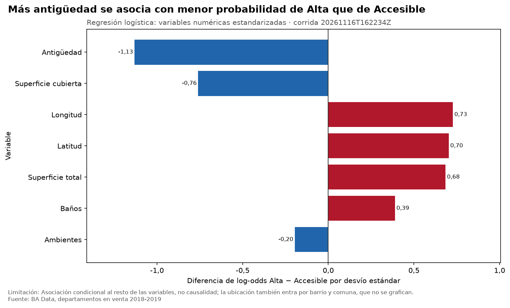

# Segmentos de valor de departamentos en venta en CABA

Trabajo final de **Programación Avanzada para la Ciencia de Datos** (Licenciatura en Ciencia de Datos, UNICABA), Opción A: *Mercado Inmobiliario*.

**Pregunta:** con las características de un departamento y su ubicación, sin mirar el precio, ¿se puede anticipar si su metro cuadrado es Accesible, Estándar o Alta para CABA?

**Respuesta corta:** sí, con un F1 macro de **0,74** en test (Random Forest), contra **0,17** de una línea base que siempre predice la misma clase. Las variables de ubicación concentran algo más de la mitad de la importancia del Random Forest.

## Contenido

- [Datos](#datos)
- [Instalación](#instalación)
- [Ejecución](#ejecución)
- [Base de datos](#base-de-datos)
- [Metodología](#metodología)
- [Resultados](#resultados)
- [Estructura del repositorio](#estructura-del-repositorio)
- [Calidad del código](#calidad-del-código)
- [Flujo de trabajo con Git](#flujo-de-trabajo-con-git)

## Datos

| | |
| --- | --- |
| Fuente | BA Data, Gobierno de la Ciudad de Buenos Aires: [Departamentos en venta](https://data.buenosaires.gob.ar/dataset/departamentos-venta) |
| Licencia | [CC BY 2.5 AR](https://creativecommons.org/licenses/by/2.5/ar/) |
| Años usados | 2018 y 2019: 173.453 avisos crudos, 168.225 después de la limpieza |
| Formato | Shapefile ESRI. Solo se lee la tabla de atributos (`.dbf`), que ya trae latitud y longitud |

Se descartaron 2017, porque le faltan antigüedad, baños, latitud y longitud, y 2020, porque tiene un esquema incompatible.

### No hace falta descargar nada para revisar el proyecto

`datasets/` no está en el repositorio, porque los `.dbf` pesan 159 MB y 133 MB y GitHub rechaza archivos de más de 100 MB. Los datos limpios ya están en la Tabla 1 de [`data/inmuebles.db`](data/inmuebles.db), junto con los resultados del entrenamiento. Con esa base alcanza para entrenar de nuevo y generar todos los gráficos.

Los datos crudos solo hacen falta para regenerar la Tabla 1 con `scripts/cargar_bd.py`.

### Descarga manual de los datos crudos

1. Entrar a la página del dataset en BA Data y descargar los shapefiles (ZIP) de cada año:
   - [Departamentos en venta 2018](https://data.buenosaires.gob.ar/dataset/departamentos-venta/resource/4512348b-d509-4b51-b46c-2f38333c8f15)
   - [Departamentos en venta 2019](https://data.buenosaires.gob.ar/dataset/departamentos-venta/resource/14daa260-29e6-4870-99f0-81884ee901ac)
2. Descomprimir cada ZIP dentro de `datasets/`, de modo que queden estas rutas. Las mayúsculas de las carpetas son distintas en cada año y tienen que coincidir:

   ```text
   datasets/
   ├── Departamentos en Venta 2018/
   │   ├── Departamentos_venta_2018.dbf
   │   ├── Departamentos_venta_2018.cpg
   │   └── ... (.shp, .shx, .prj)
   └── Departamentos en venta 2019/
       ├── Departamentos_venta_2019.dbf
       ├── Departamentos_venta_2019.cpg
       └── ...
   ```

Si los datos están en otro lugar, se indica con `--crudos` la carpeta que contiene las dos subcarpetas de los años, con estos mismos nombres (ver [Ejecución](#ejecución)).

## Instalación

Requiere **Python 3.12**. Las versiones exactas de las librerías están fijadas en [`requirements.txt`](requirements.txt), que además instala el paquete del proyecto (`inmuebles`) en modo editable.

### Opción 1: `venv` y `pip`

```bash
git clone https://github.com/nicoCalde/proyecto-final-pacd-inmuebles-caba.git
cd proyecto-final-pacd-inmuebles-caba
# Windows
py -3.12 -m venv .venv
# Linux o macOS
python3.12 -m venv .venv
```

Activar el entorno:

```bash
# Windows (PowerShell)
.venv\Scripts\Activate.ps1
# Windows (Git Bash)
source .venv/Scripts/activate
# Linux o macOS
source .venv/bin/activate
```

E instalar las dependencias:

```bash
python -m pip install -r requirements.txt
```

### Opción 2: `uv`

```bash
git clone https://github.com/nicoCalde/proyecto-final-pacd-inmuebles-caba.git
cd proyecto-final-pacd-inmuebles-caba
uv venv --python 3.12
uv pip install -r requirements.txt
```

`uv pip` instala en el entorno que esté activado. Si hay otro entorno activo (por ejemplo, el de otro proyecto), hay que ejecutar `deactivate` antes de instalar, o se instala en ese.

Después se activa `.venv` igual que en la opción 1 y se usan los mismos comandos. No conviene `uv run` sin `--no-sync`: crea un `uv.lock` que el proyecto no usa.

### Verificar la instalación

```bash
pytest
```

Tienen que pasar los 410 tests. Usan datos sintéticos chicos, así que no necesitan `datasets/` ni la base.

## Ejecución

El proyecto se corre con tres scripts, en este orden. Cada uno lee lo que dejó el anterior:

```text
datasets/ ──cargar_bd.py──▶ Tabla 1 ──entrenar.py──▶ Tablas 2 y 3 + modelo ──generar_graficos.py──▶ reports/figures/
```

| Paso | Comando | Lee | Escribe | Tiempo aprox. |
| --- | --- | --- | --- | --- |
| 1 | `python scripts/cargar_bd.py` | `datasets/` | Tabla 1 en `data/inmuebles.db` | 10 s |
| 2 | `python scripts/entrenar.py` | Tabla 1 | Tablas 2 y 3, `models/mejor_modelo.joblib` | 5 min |
| 3 | `python scripts/generar_graficos.py` | Base de datos | 9 PNG en `reports/figures/` | 5 s |

**Sin los datos crudos**, se puede empezar directamente en el paso 2, porque la base versionada ya tiene la Tabla 1.

**Cada entrenamiento agrega una corrida nueva** a la base, con su propio `run_id`, y `generar_graficos.py` grafica la última. Para probar sin modificar la base entregada, se puede trabajar sobre una copia con `--db`, o restaurarla después con `git checkout data/inmuebles.db`. Con la misma semilla y los mismos datos, la corrida nueva reproduce exactamente las métricas y las predicciones de la versionada.

En Windows con Git Bash, si los acentos se ven mal en la consola, conviene definir `PYTHONIOENCODING=utf-8` antes de correr los scripts.

### Opciones de cada script

Todas las rutas tienen valores por defecto en [`src/inmuebles/config.py`](src/inmuebles/config.py). `--help` muestra la ayuda de cada script.

| Script | Opción | Uso |
| --- | --- | --- |
| `cargar_bd.py` | `--crudos CARPETA` | Carpeta de los datos crudos (por defecto, `datasets/`) |
| | `--reemplazar-corridas` | Si los datos limpios cambiaron, borra las corridas guardadas. Sin esta opción, la carga se niega a dejar corridas que apunten a avisos distintos |
| `entrenar.py` | `--rapido` | Grillas reducidas, para una demo (unos 2 minutos, F1 test 0,72). La entrega usa las grillas completas |
| | `--n-jobs N` | Procesos en paralelo (por defecto, `-1`: todos los núcleos) |
| | `--modelo RUTA` | Dónde guardar el modelo `.joblib` |
| `generar_graficos.py` | `--run-id ID` | Corrida a graficar (por defecto, la última) |
| | `--salida CARPETA` | Carpeta de los PNG (por defecto, `reports/figures/`) |
| Los tres | `--db RUTA` | Base SQLite (por defecto, `data/inmuebles.db`) |
| | `--logs CARPETA` | Carpeta de los logs (por defecto, `logs/`) |

### Logs y errores

Cada ejecución escribe en consola y en un archivo `logs/<script>_<fecha UTC>.log`, con tres niveles:

- **INFO:** el avance, como las filas leídas, la partición o las métricas.
- **WARNING:** los datos descartados o enmascarados en la limpieza.
- **ERROR:** las entradas faltantes o inválidas.

Ante un error esperable, como un archivo que falta o una base sin la Tabla 1, el script explica qué hacer y termina con código 1. En el log de `entrenar.py`, la fecha del nombre del archivo es el `run_id` de la corrida.

El modelo entrenado (unos 200 MB) no se versiona porque supera el límite de GitHub. Se regenera con `entrenar.py`, y los gráficos no lo necesitan, porque salen de la base.

## Base de datos

[`data/inmuebles.db`](data/inmuebles.db) es un archivo SQLite de unos 21 MB, versionado en el repositorio. Contiene los datos limpios y **una corrida** entrenada con las grillas completas (`run_id` `20261116T162234Z`).



| Tabla | Rol en la consigna | Filas | Contenido |
| --- | --- | --- | --- |
| `propiedades_limpias` | Tabla 1 | 168.225 | Un aviso limpio por fila: año, barrio, comuna, antigüedad, m², ambientes, baños, latitud, longitud y precio |
| `predicciones` | Tabla 2 | 100.935 | Segmento real y predicho de cada aviso de test, para los 3 modelos |
| `metricas` | Tabla 2 | 24 | Accuracy, precision, recall y F1 de cada modelo, en CV (media ± desvío) y en test |
| `modelos_config` | Tabla 3 (extra) | 3 | Clase, hiperparámetros elegidos y parámetros completos de cada modelo, en JSON |
| `ejecuciones` | Auxiliar | 1 | Una fila por corrida: fecha, modelo elegido, umbrales de los segmentos, semilla y tamaños de train y test |
| `importancias` | Auxiliar | 280 | Importancias del Random Forest y coeficientes de la regresión logística, que alimentan los gráficos de interpretación |
| `matriz_confusion` | Vista | — | Conteos real × predicho, calculados desde `predicciones` |

El esquema es DDL explícito, en [`src/inmuebles/database.py`](src/inmuebles/database.py). Tiene claves primarias y foráneas con `PRAGMA foreign_keys=ON`, y restricciones `CHECK`, como que un segmento solo puede ser Accesible, Estándar o Alta. Cada escritura corre en una sola transacción y es idempotente: volver a cargar los mismos datos limpios, o reescribir el mismo `run_id`, no duplica filas. Después de cada carga se validan las columnas y la cantidad de filas.

### Consultar la base

Sin instalar nada más que Python:

```python
import sqlite3

import pandas as pd

con = sqlite3.connect("data/inmuebles.db")
pd.read_sql(
    """
    SELECT modelo, metrica, origen, ROUND(media, 3) AS media, ROUND(desvio, 3) AS desvio
    FROM metricas
    WHERE metrica = 'f1'
    ORDER BY modelo, origen
    """,
    con,
)
```

También se puede abrir con [DB Browser for SQLite](https://sqlitebrowser.org/) o con la extensión de SQLite de VS Code.

## Metodología

Todas las decisiones, con su motivo, están en el [registro de decisiones](docs/decisiones.md). Las principales:

**Target.** El segmento de valor se define por los terciles del precio en USD por m². Los umbrales se calculan **solo con train**: 2.711 y 3.453 USD/m². Los tres segmentos quedan balanceados, y el USD/m² permite comparar departamentos de distinto tamaño.

**Sin fuga de información (*leakage*).** Ninguna columna derivada del precio entra como feature: `PRECIOUSD`, `PRECIOARS`, `PRECIOUSDM`, `PRECIOARSM` y `CAMBIO`. Un test lo verifica. Las features son antigüedad, m² totales y cubiertos, ambientes, baños, latitud, longitud, barrio y comuna.

**Limpieza.**
- Se conservan solo las ventas de departamentos.
- Los nombres de columna se unifican entre 2018 y 2019, y los barrios se normalizan a los 48 oficiales.
- Se eliminan los duplicados.
- Los valores fuera de un rango plausible pasan a nulo sin borrar la fila.
- Se descartan las filas sin precio válido y las que tienen más m² cubiertos que totales.
- Se descartan los extremos del USD/m² (percentiles 1 y 99). Se calculan sobre todo el dataset, antes de la partición: quitan errores de carga, y los cortes casi no dependen de qué avisos caigan en test.

**Partición.** 80/20, estratificada por deciles auxiliares del USD/m². El target no se puede usar para estratificar, porque existe recién después de la partición.

**Pipeline.** Toda la preparación vive dentro de un `Pipeline` de scikit-learn, que se ajusta solo con train:
- Numéricas: imputación por mediana y `StandardScaler`.
- Categóricas: imputación por moda y one-hot con `handle_unknown="ignore"`.

**Modelos.** Se compara una `LogisticRegression` contra un `RandomForestClassifier`, con un `DummyClassifier(strategy="most_frequent")` como línea base:
- Cada modelo se ajusta con `GridSearchCV`, `StratifiedKFold(5)` y las cuatro métricas de la consigna, con `refit="f1_macro"`.
- El modelo se elige por la media de CV.
- El conjunto de test se usa **una sola vez**, al final, para confirmar.
- La semilla es `random_state=42`.

## Resultados

Gráficos generados desde la base con `scripts/generar_graficos.py`. Cada título enuncia el hallazgo, y al pie de cada gráfico van su limitación y la fuente.

### Los datos







### Los modelos

| Modelo | F1 macro CV (media ± desvío) | F1 macro test | Accuracy test |
| --- | --- | --- | --- |
| **Random Forest** (200 árboles, sin límite de profundidad) | **0,729 ± 0,001** | **0,739** | **0,739** |
| Regresión logística (`C=1`) | 0,610 ± 0,002 | 0,610 | 0,614 |
| Línea base (clase más frecuente) | 0,167 ± 0,000 | 0,167 | 0,334 |





El F1 de test difiere a lo sumo 0,01 del de CV, así que la validación cruzada anticipó bien el desempeño sobre datos nuevos. El test del Random Forest queda apenas por encima, probablemente porque el modelo final se reentrena con todo train y cada fold usa el 80 %. Esto no mide el sobreajuste, que se ve comparando contra train: un bosque sin límite de profundidad ajusta train casi perfecto, y por eso se eligió por CV.





Estándar es el segmento más difícil para los dos modelos: al ser el tercil del medio, limita con los otros dos. 9 de cada 10 errores del Random Forest son entre segmentos vecinos, y solo el 3,6 % de los avisos Accesibles y Altos se confunde con el segmento opuesto.

### La interpretación





Las importancias y los coeficientes muestran **asociación, no causalidad**. Además, m² totales y cubiertos están muy correlacionados, así que sus coeficientes se compensan entre sí y no conviene leerlos por separado.

### Limitaciones

- Son precios **publicados** en avisos, no precios de cierre, y solo de 2018 y 2019.
- Un departamento cerca de un umbral puede quedar de un lado o del otro por pocos dólares. La mitad de los errores del Random Forest está a menos de 200 USD/m² de un umbral, contra el 27 % de los aciertos.
- Hay variables que el dataset no trae, como el estado, las amenidades o el piso, que seguramente explican parte de lo que el modelo no captura.

## Estructura del repositorio

```text
├── data/inmuebles.db        Base SQLite entregable (versionada)
├── datasets/                Datos crudos (no versionados, ver "Datos")
├── docs/decisiones.md       Registro de decisiones con su motivo
├── reports/figures/         Gráficos PNG generados desde la base
├── scripts/                 Orquestadores con argparse, sin lógica propia
│   ├── cargar_bd.py         datasets/ → Tabla 1
│   ├── entrenar.py          Tabla 1 → Tablas 2 y 3 + modelo
│   └── generar_graficos.py  Base → reports/figures/
├── src/inmuebles/           Paquete con la lógica, un módulo por responsabilidad
│   ├── config.py            Rutas, constantes, grillas y etiquetas
│   ├── data_loading.py      Lectura de los .dbf y unificación de columnas
│   ├── cleaning.py          Limpieza y normalización
│   ├── target.py            Segmentos por terciles ajustados en train
│   ├── preprocessing.py     ColumnTransformer de features
│   ├── modeling.py          Partición, GridSearchCV y selección por CV
│   ├── evaluation.py        Métricas de test, matrices e importancias
│   ├── database.py          Esquema, escritura y lectura de SQLite
│   ├── visualization.py     Gráficos (matplotlib)
│   └── logging_setup.py     Logging a consola y archivo
├── tests/                   Tests de pytest, uno por módulo
├── requirements.txt         Dependencias con versión exacta
├── .flake8                  Configuración de flake8
└── pyproject.toml           Paquete y configuración de pytest y black
```

No se versionan `datasets/` (más de 100 MB), `models/` (unos 200 MB), `logs/` ni `.venv/`.

## Calidad del código

```bash
pytest
black --check src scripts tests
flake8 src scripts tests
```

- **Estilo:** PEP 8, con la guía de Google donde PEP 8 no dice nada. Los docstrings siguen numpydoc. Se formatea con `black` (88 columnas) y se verifica con `flake8`, `flake8-docstrings` y `pep8-naming`, con complejidad ciclomática máxima de 5.
- **Desarrollo guiado por tests:** cada etapa siguió el ciclo Red → Implementación → Green.
  - **Red:** primero se escribe un test que falla.
  - **Implementación:** se escribe el código mínimo que lo hace pasar.
  - **Green:** el test pasa sin romper los anteriores. Además, se introdujeron errores a propósito en el código (pruebas de mutación manuales) para comprobar que los tests los detectan, y se agregaron tests para los que no.

  Al final de cada etapa hubo una revisión independiente de la metodología y el código.
- **Tests:** usan datos sintéticos generados en [`tests/conftest.py`](tests/conftest.py), nunca `datasets/`.

## Flujo de trabajo con Git

- Desde la Etapa 2, `main` solo recibe cambios por Pull Request: cada etapa del plan tiene su rama `feature/...` y su PR.
- Cada PR se integró a `main` como un único commit con el número del PR, por ejemplo `(#7)`. Los commits de trabajo de cada etapa se conservan en su PR de GitHub.
- Los mensajes de commit están en español y, salvo el de la Etapa 3, usan los prefijos de *Conventional Commits* (`feat:`, `fix:`, `docs:`).
